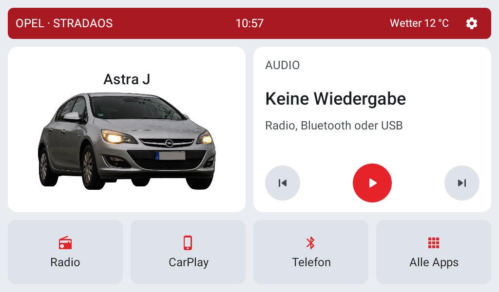
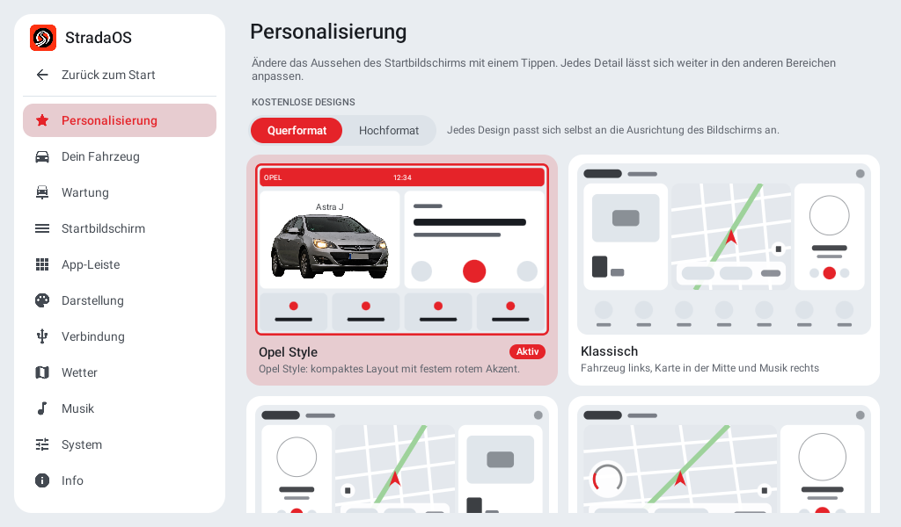

<div align="center">

<h1>StradaOS Opel</h1>
<b>A new life for your Android car head unit</b>
<br><br>
<a href="https://github.com/lordnordic-debug/StradaOS/releases"></a>
<a href="https://github.com/lordnordic-debug/StradaOS/releases"></a>

<a href="LICENSE"></a>
<br><br>
<a href="https://github.com/L0r3nz-H/StradaOS-Opel/releases/latest">Download StradaOS Opel</a> · <a href="https://lordnordic-debug.github.io/StradaOS/?lang=en">Upstream website</a> · <a href="https://github.com/lordnordic-debug/StradaOS">Original StradaOS</a>
</div>

---

**StradaOS** is a **free, ad-free, open-source launcher** for Android car head units. Install it like any other app, **without flashing firmware or replacing Android**. Uninstall it to return to the previous setup. It was created for older radios advertised as Android 6 or newer that actually run Android 4.x, and also supports modern devices.

This fork of [lordnordic-debug/StradaOS](https://github.com/lordnordic-debug/StradaOS) adds **Opel Style**, a compact dashboard for 7-inch 1024 × 600 displays. It includes a transparent Astra J photo, two large content areas, centered clock, optional GPS speed, and four large shortcuts: **Radio, CarPlay or Android Auto, Phone, All apps**. Select the first card under **Settings → Personalization → Landscape**. Select a standard or premium theme in the same gallery to return to a regular StradaOS layout. Opel Style uses a fixed red accent, so accent-color controls are hidden there. Dark, Light, Auto, and System modes remain available.

See [Opel APK installation](docs/OPEL_APK.md), [compact-mode design notes](docs/COMPACT_7_INCH_PLAN.md), and [Opel design history](docs/OPEL_NAVI_900_MODERN.md). The separate app is named **StradaOS Opel** and uses `com.stradaos.launcher.opel`.

## Current Opel edition

The Opel sync candidate tracks published upstream **2.38.0**
(commit `128769a`), version **2.38.0-opel**, versionCode **75**, with package
`com.stradaos.launcher.opel` and app name **StradaOS Opel**.
The latest published preview is [2.35.0](https://github.com/L0r3nz-H/StradaOS-Opel/releases/tag/opel-2.35.0-preview.1);
stable Latest remains 2.22.0. A candidate is published only after all hosted checks pass.
Earlier Opel branches and releases remain available. The upstream badges describe
the original project; Opel downloads use this fork.

Hosted verification covers builds, unit tests, strict lint, metadata/signatures,
original debug UI tests and signed Opel installation/three cold starts on APIs
16, 19, 21, 23, 24, 28, 30 and 34. Additional API 30 checks cover gallery,
controls and per-style themes. API 17 and proprietary head-unit hardware remain
untested; the 2.38.0 candidate is pending these checks.
See [testing](docs/PRUEBAS.md) for checks and compatibility exceptions.

| Option | StradaOS | Opel Style |
| --- | --- | --- |
| Home layout | Existing configurable layout, including portrait | Two large panels for a 7-inch landscape display |
| Accent | Ten selectable colors | Fixed red; accent controls are hidden |
| Theme | Dark, Light, Auto, System | The same modes, stored independently |
| Main content | Vehicle, map/projection, and media options | Vehicle photo or map, plus large media controls |
| Shortcuts | Existing configurable dock | Radio · CarPlay or Android Auto · Phone · All apps, or the existing dock |

Selecting Opel Style preserves standard colors, theme modes, photos, app assignments
and the saved premium theme. Selecting another gallery card applies that standard or
premium layout. Personalization stays available while Opel Style is active. Older separate Opel/compact selections migrate to Opel Style.
The Opel edition starts in Opel Style on first installation.

Choose **CarPlay** or **Android Auto** for the second large shortcut during
Opel setup (after language selection), or later under **Settings → Connections
→ Opel home projection**. This selector is visible only in Opel Style. The
choice updates the label, icon, and launch action, and survives restarts/style
changes. CarPlay remains the default for existing installations. The normal
configurable StradaOS dock and its app assignments are retained.

Settings follow the active Opel layout: standard-only card arrangements,
vehicle tags/greetings, gauges, header status icons, navigation buttons, and
home maintenance badges are hidden. Map controls appear only for the selected
map panel; live-map options require its live view. Fixed shortcuts omit normal
dock layout/icon/count controls; selecting the configurable dock restores its
supported controls. With four fixed shortcuts, Connections shows only the chosen projection app;
the configurable dock keeps both projection-app assignments. Hidden standard
preferences remain stored and return when switching back to StradaOS.

The vehicle panel shows **Astra J** above the transparent bundled photo; a user
photo takes priority in both compact and standard views of the Opel edition.
Tap the image or use Settings → Your vehicle → Vehicle photo to choose another
photo and confirm **Use this**. Removing a custom photo restores the bundled
Astra image. Optional GPS speed is centered beneath it. With speed off,
the name and image are centered together. The clock stays centered in the header.
The compact dashboard has no direct navigation shortcut; navigation apps remain
available through All apps and the standard navigation assignment.

Temperature is displayed only when valid, fresh weather data is available and
is labeled as weather. Without it, the temperature area stays empty. Reading the
car's outside temperature is planned but **not implemented**: the target radio's
exposed interface has not been confirmed.

<p align="center">


</p>

Actual Android 11/API 30 emulator captures at 1024 × 600: dashboard from
2026-11-16 and the current Personalization gallery from 2026-11-18.
The app is shown in German; repository documentation is in English.
See the [screenshot index](docs/screenshots/compact/README.md) for historical captures.

## Features

### Dashboard

- **Optional built-in navigation:** upstream 2.23.0 adds destination search, voice guidance, route alternatives and approximate offline routing. It stays off until selected in the standard layout.

- **Live and offline maps:** download a free OpenStreetMap-derived country map in the app, then use it without internet. Map/arrow motion is interpolated between GPS readings.
- **Android Auto and CarPlay shortcuts:** open the head unit's projection app or [Open Headunit](https://github.com/andreknieriem/headunit-revived) over USB.
- **Music:** Bluetooth title, artist, and playback time with large controls. Android Auto and local music apps can also supply artwork.
- **Speedometer, weather, clock, and oil-change reminders.**
- **Vehicle photo**, with optional background removal.

### Standard-layout customization

- Player left/right, vehicle card shown/hidden, and collapsible Android Auto/CarPlay controls.
- Normal, compact, side, or hidden dock; vertical player for low, wide displays such as 1280 × 480.
- Dark, Light, Auto with a configurable schedule, and System theme modes; ten accent colors in the standard style.
- Portrait layout, analog/mixed speedometer options, and custom maintenance reminders.
- Settings/photo backups to local storage or USB and an optional app opened at boot.

### Personalization

- Assign installed apps or functions to shortcuts and hide unused apps from the drawer.
- Twelve app languages: Spanish, English, Portuguese, French, Italian, German, Malay, Arabic, Turkish, Chinese, Hungarian, and Polish. Speed in km/h or mph.
- App drawer sorting, an optional idle screen, and GPS-based sunrise/sunset themes are also available.
- Standard upstream releases offer update notifications and a QR download link. The Opel edition uses separately signed APKs instead.

Upstream release notes are available in [Releases](https://github.com/lordnordic-debug/StradaOS/releases). Markdown documentation in this fork is in English; app translations and historical screenshot languages are unchanged.

## Installation

For **StradaOS Opel**:

1. Download **[StradaOS-Opel-2.22.0.apk](https://github.com/L0r3nz-H/StradaOS-Opel/releases/download/v2.22.0/StradaOS-Opel-2.22.0.apk)**
   from the [latest Opel release](https://github.com/L0r3nz-H/StradaOS-Opel/releases/latest). A SHA-256 checksum is attached.
   The [historical 2.16.0 release](https://github.com/L0r3nz-H/StradaOS-Opel/releases/tag/v2.16.0) is also available.
   See [OPEL_APK.md](docs/OPEL_APK.md) for installation and signing details.
2. Copy the APK to the **Android head unit**, open it with the file manager,
   and allow installation from that source if requested.
3. Open **StradaOS Opel**, complete setup, and select it as the home app if desired.
   Change styles through **Settings → Personalization → Landscape**.

It installs alongside standard StradaOS and does not automatically import its
settings. Updates must use the same Opel package and signing key; standard
upstream APKs and update notifications are not used for this edition.
A CarPlay-only display without Android APK installation cannot run this launcher.
The CarPlay shortcut opens the compatible projection app already installed on
the Android unit; it does not add projection support to unsupported hardware.

To build locally, use JDK 17 and Android SDK 35:

```sh
./gradlew assembleDebug assembleOpel lintOpel
```

`assembleOpel` produces an **unsigned** intermediate APK. Follow the alignment
and signing instructions in [OPEL_APK.md](docs/OPEL_APK.md) before installation.

For **standard upstream StradaOS**:

1. Download `StradaOS-x.y.z.apk` from [upstream releases](https://github.com/lordnordic-debug/StradaOS/releases/latest) and copy it to the unit. If using USB, copy it to internal storage first.
2. Allow unknown-source installation in Android security settings and install the APK.
3. Press Home and choose StradaOS → Always. Complete the setup wizard.

For Android Auto on units without it, install [Open Headunit](https://github.com/andreknieriem/headunit-revived/releases), connect the phone by USB, and use the Android Auto button. Enable Android Auto artwork under Settings → Music.

## Compatibility

Minimum Android version is **4.1/API 16**, with target SDK 28. The compact
layout targets **1024 × 600 landscape** Android radios, including Android 4.2/API
17, without firmware or screen-resolution changes. The standard layout retains
portrait support.

The earlier 2.21.2-opel build was installed and checked on an Android 11/API 30 emulator:
style switching, accent visibility, restart persistence, and old-preference
migration passed. **API 17 runtime and proprietary radio/Bluetooth/CarPlay behavior
still need testing on the actual head unit.** Upstream hardware reports do not
replace testing this fork.

Builds and automated checks are described in [testing](docs/PRUEBAS.md).
Lint errors fail the build. The intentionally retained target SDK 28 produces a visible
informational Google Play policy finding; changing it requires a separate compatibility
migration for legacy head units.

Report additional devices through the [issue tracker](https://github.com/L0r3nz-H/StradaOS-Opel/issues).

## Frequently asked questions

<details><summary><b>Why “OS” if this is not an operating system?</b></summary>
“OS” stands for <b>Open Source</b>. StradaOS changes the home screen, not Android or firmware. “Strada” means “road” in Italian: an open-source launcher for the road.
</details>

<details><summary><b>The factory menu appears at boot</b></summary>
Set StradaOS as the home app in <b>Settings → System</b>. If the head unit still starts its factory menu, enable <b>Open StradaOS on boot</b> there.
</details>

<details><summary><b>Why is Bluetooth artwork missing?</b></summary>
The tested Bluetooth link between phone and radio supplies title, artist, and time, but not an image. Android Auto and music apps installed on the unit can supply artwork.
</details>

<details><summary><b>Bluetooth music stops or is silent</b></summary>
Leave the Bluetooth app with <b>Home</b>, not Back. Check <b>Settings → Music → Bluetooth audio</b> and its troubleshooting help.
</details>

<details><summary><b>The map or my location is missing</b></summary>
Live maps require internet; downloaded offline maps do not. For missing GPS, check the radio's GPS antenna, permission, and location settings. Long-press the map for diagnostics.
</details>

<details><summary><b>How do I stop using StradaOS?</b></summary>
Use <b>Settings → System</b> to return to the factory launcher or uninstall. If the screen goes black, restart the unit using its RES button or a power cycle.
</details>

## Privacy

No accounts, advertising, or analytics. Location is processed locally, with map/weather requests as detailed in [PRIVACY.md](PRIVACY.md).

## Supporting the original project

StradaOS is free. Star the repository or support the upstream author at [ko-fi.com/stradaos](https://ko-fi.com/stradaos). Reports, ideas, and translations are welcome; see [CONTRIBUTING.md](CONTRIBUTING.md).

<a href="https://github.com/lordnordic-debug/StradaOS/graphs/contributors"></a>

## License and credits

[GNU GPL v3.0](LICENSE). Maps © [OpenStreetMap contributors](https://www.openstreetmap.org/copyright), OpenTopoMap, and Esri. Offline-map reader adapted from [mapsforge](https://github.com/mapsforge/mapsforge), LGPL-3.0, with maps from [download.mapsforge.org](https://download.mapsforge.org/). Weather: [Open-Meteo](https://open-meteo.com). Android Auto: [Open Headunit](https://github.com/andreknieriem/headunit-revived), GPL-3.0. QR generation: [Project Nayuki](https://github.com/nayuki/QR-Code-generator), MIT. Icons: [Material Symbols](https://fonts.google.com/icons), Apache 2.0.

This is an independent project, not affiliated with Google, Apple, Opel, or any vehicle/head-unit manufacturer. Android Auto is a trademark of Google LLC; CarPlay is a trademark of Apple Inc. Do not operate the UI while driving.
