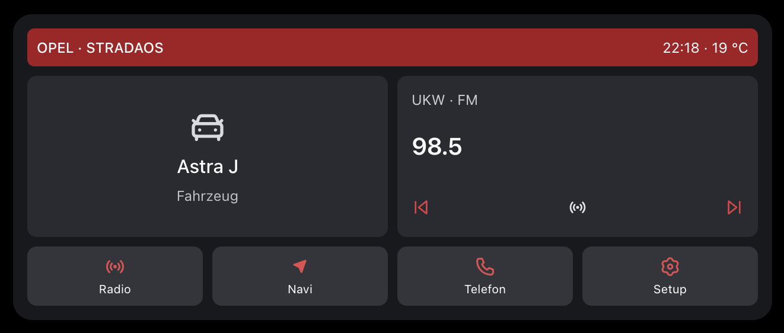

# Optionaler 7-Zoll-Kompaktmodus – Analyse und Implementierungsplan

Stand: 10.11.2026. Der erste Kompaktmodus ist inzwischen implementiert; der
ursprüngliche Plan und noch offene Punkte sind unten beschrieben.
Zielgerät: Android-Autoradio mit 1024 × 600 Pixeln, insbesondere
Android 4.2 / API 17. Referenz: der bereitgestellte Entwurf mit roter Kopfleiste,
zwei großen Inhaltsflächen und vier unteren Tasten. Die gewünschte Belegung hat
Vorrang vor den Beschriftungen im Bild: **Radio · CarPlay · Telefon · Alle Apps**.

## Umgesetzter Stand und Validierung

- Einstellungen → Darstellung → Layout: Standard oder 7-Zoll-Kompaktmodus.
  Fahrzeug/Karte und vier große Schnellzugriffe sind separat wählbar.
- Zwei große Flächen, große Texte/Medienbuttons und Viererleiste umgesetzt;
  Opel kombiniert sie mit roter Kopfleiste und der mitgelieferten Aufnahme.
  Eigene Fahrzeugfotos haben Vorrang. Navigation bleibt über die Taste in
  der linken Fläche erreichbar. Die App-Liste verwendet vier große Spalten.
- Der Fahrzeugname steht über dem Foto. Eine zusätzliche Beschriftung
  „Fahrzeug“ wird in der Kompaktansicht nicht angezeigt.
- Optional unter Darstellung: „GPS-Geschwindigkeit anzeigen“, standardmäßig
  ausgeschaltet (`compact_show_speed=false`). Im Fahrzeugmodus erscheint sie
  unter dem Foto; im Kartenmodus erscheint sie unten
  als Fläche neben der Navigationstaste. Sie verwendet dieselben GPS-Updates
  und die vorhandene km/h-/mph-/Auto-Einstellung wie die Standardansicht.
  Ohne gemeldete Geschwindigkeit oder bei über sechs Sekunden alten GPS-Daten
  erscheint „—“. Antippen öffnet die vorhandene GPS-Hilfe/Berechtigungsabfrage.
- Das bisherige Layout bleibt der Standard für fehlende/unbekannte Werte.
  Layoutpräferenzen überschreiben keine bisherigen Dock-Zuordnungen.
- Derzeit wird ausschließlich verfügbare Wettertemperatur angezeigt und als
  „Wetter“ gekennzeichnet, mit maximal einer Stunde Datenalter; andernfalls „—“.
  Der unten geplante Fahrzeug-Leseadapter ist **noch nicht implementiert**;
  eine tatsächliche Schnittstelle des Zielradios muss erst ermittelt werden.
- `assembleDebug` und `lintDebug` erfolgreich ausgeführt. Der Lint-Bericht
  enthält weiterhin 60 Errors, 1 Fatal und 60 Warnings. Keine Errors/Fatals auf
  neuen/geänderten Java-Zeilen; dort zwei Warnungen zu `Gravity.RIGHT` (RTL).
  Ein erfolgreicher Lint-Task ist wegen `abortOnError false` kein sauberer Befund.
- Laufzeitansichten auf Android 11 / API 30, 1024 × 600, 160 dpi kontrolliert:
  Kompakt/Fahrzeug, Kompakt/Karte, Rückwechsel zum bisherigen Opel-Layout,
  Zahnrad/Einstellungen und App-Liste mit vier Spalten. API 17 sowie echte
  Radio-, CarPlay-, Bluetooth- und Fahrzeugtemperaturdaten sind noch zu prüfen.
- Echte Aufnahmen: [Kompaktansicht](screenshots/compact/01-opel-compact-1024x600.png)
  und [App-Liste](screenshots/compact/02-apps-1024x600.png).
- Optionale Geschwindigkeit auf API 30 mit Emulator-GPS geprüft: 72 km/h
  (38,8769 Knoten), gerundet 45 mph bei automatischer US-Einheit, Stillstand
  sowie „—“ nach deaktiviertem Standort. Fahrzeug- und Kartenansicht bleiben
  bedienbar. [Aufnahme mit simulierten 72 km/h](screenshots/compact/03-gps-speed-simulated-1024x600.png).
- Debug-Hooks: `--es prueba layout:compact_7`, `layout:standard`,
  `compact-panel:vehicle` und `compact-panel:map`.

## Mitgelieferte Bildvorlagen

Die beiden Originaldateien sind unverändert im Repository abgelegt und damit
auch unabhängig von den Chat-Anhängen verfügbar.

Layoutreferenz (die unteren Tasten werden wie oben gewünscht angepasst):

Fahrzeugbild für die linke Fläche des Opel-Kompaktmodus:

Bei der Umsetzung soll dieses Foto als mitgeliefertes Ersatzbild für die
Opel-Kompaktansicht verwendet werden, wenn kein eigenes Fahrzeugfoto hinterlegt
ist. Ein über `CarPhoto` ausgewähltes Nutzerfoto hat Vorrang; andere Designs und
das bisherige Standardlayout erhalten dadurch kein neues Standardfahrzeug.
Das ganze Fahrzeug proportional mit `FIT_CENTER` darstellen, ohne Beschnitt
oder Verzerrung. Die Original-JPEG-Datei bleibt als Referenz erhalten. Die App
verwendet die freigestellte Variante `app/src/main/assets/opel_astra_j.png` mit
echtem Alphakanal, damit der Kachelhintergrund um das Fahrzeug sichtbar bleibt.
Beim Laden wird sie mit `inSampleSize=2` dekodiert, um den Speicherbedarf auf
älteren Geräten gering zu halten. Transparente Nutzerfotos werden weiterhin
über `CarPhoto.load()` unverändert bevorzugt.

## Befund im Repository

- `app/src/main/java/com/stradaos/launcher/Main.java` enthält die Activity,
  programmatisch erzeugte Views, Einstellungen und App-Aktionen. Es gibt keine
  XML-Dashboard-Layouts. `build()` erstellt das Dashboard über `buildTop()`,
  `buildCarCard()`, `buildAaCard()`, `buildAudioCard()` und `buildDock()`.
- `s = min(Breite / 1024, Höhe / 600)` skaliert die virtuelle Zeichenfläche;
  `ex` verteilt zusätzliche Breite. `place()` und `tv()` verwenden skalierte
  Pixel, keine dp-/sp-basierten Layoutressourcen. Ein bloßes neues
  `layout-sw600dp` würde diese Architektur deshalb nicht umstellen.
- Standard: Fahrzeugkarte (300 × 380), Karten-/Projektionskarte (420 × 380),
  Audiokarte (248 × 380); unten sieben frei belegbare Tasten. Viele sekundäre
  Texte sind lediglich 11–15 virtuelle Pixel groß.
- Das bestehende Design `opel_navi_900_modern` ist bereits über Darstellung →
  Design auswählbar. `OpelDesign.java` liefert Palette und Panelstil;
  `Main.java` erweitert die Karte auf 624 × 380 und Audio auf 356 × 380,
  entfernt die Fahrzeugkarte und behält sieben Tasten. Es ist also bereits
  vorhanden, entspricht aber noch nicht dem gezeigten Kompaktentwurf.
- Einstellungen liegen in `SharedPreferences("launcher")`: unter anderem
  `design`, `theme`, `accent`, `dock_0` bis `dock_6`, `car_name`, `car_tag`,
  `nav_app`, `carplay`, `bt` und `map_live`. `setDesign()` und `rebuild()` bauen
  die Ansicht neu auf, ohne die Activity samt Medienanbindung neu zu starten.
- Die App-Übersicht `openDrawer()` zeigt aktuell sechs Spalten. Die bestehenden
  Einstellungen werden mit `showSettings()` und den `cat…()`-Methoden aufgebaut.
- `map_live=false` ersetzt nur die Live-Karte durch eine dekorative Karte;
  eine Fahrzeugansicht als Kartenersatz gibt es noch nicht.
- `app/build.gradle` setzt `minSdk 16`, `targetSdk 28`, Java 8 und hat keine
  externe UI-Bibliothek. API 17 liegt damit im unterstützten Bereich; dies
  ersetzt keinen Laufzeittest auf Android 4.2.
- Übersetzungen kommen über `I18n` aus `assets/i18n/*.txt` mit spanischen
  Quelltexten und unter anderem deutschen Übersetzungen.
- Eine Anbindung an Fahrzeug-Außentemperatur ist im untersuchten Java-Code
  noch nicht vorhanden. `Weather.java` liefert bisher eine Wettertemperatur
  aus dem Internet. Welche Fahrzeugschnittstelle das Zielradio zugänglich
  macht, ist noch nicht nachgewiesen.

## Architekturentscheidung

Layoutdichte und Design werden unabhängig gewählt:

| Einstellung | Werte / Vorgabe | Wirkung |
| --- | --- | --- |
| `home_layout` (neu) | `standard` / `compact_7`; Vorgabe `standard` | Bestehender Layoutpfad oder neues Kompaktlayout |
| `design` (bestehend) | StradaOS / Opel Navi 900 Modern | Palette und visuelle Gestaltung bleiben auswählbar |
| `compact_main_panel` (neu) | `vehicle` / `map`; Vorgabe `vehicle` | Linke große Inhaltsfläche im Kompaktmodus |
| `compact_four_shortcuts` (neu) | boolean; Vorgabe `true` | Vier feste Funktionen oder vorhandene Siebenerleiste |
| `compact_show_speed` (neu) | boolean; Vorgabe `false` | Optionale GPS-Geschwindigkeit in Fahrzeug- und Kartenansicht |

Fehlende oder unbekannte Layoutwerte führen zum bisherigen Layout. Es gibt
keine automatische Aktivierung anhand der Pixelzahl: Daraus lässt sich die
physische Bildschirmdiagonale nicht zuverlässig bestimmen. Bestehende
Installationen und die bisherige Opel-Ansicht bleiben unverändert auswählbar.
Die neuen Optionen wirken nur bei aktivem Kompaktmodus.

`CompactLayout.java` soll Geometrie, Textgrößen und die vier Funktionskennungen
zentral definieren. Die Anbindung an bestehende Activity-Aktionen bleibt in
kleinen `buildCompact…()`-Methoden in `Main.java`. Kein umfassender Umbau der
bisherigen Darstellung oder Dienste ist dafür erforderlich.

Die Kombination **Kompaktmodus + Opel Navi 900 Modern + Fahrzeugansicht + vier
Tasten** wird die Grundlage für den gezeigten Opel-Entwurf. Opel verwendet dabei
seine bestehende dunkle Palette mit roter Kopfleiste, roten Aktionsicons und
heller Schrift. Die bisherigen Opel-Geometrien bleiben im Standardlayout aktiv.

## Geplante Oberfläche bei 1024 × 600

Alle Maße sind virtuelle Basispixel; sie werden weiterhin mit `s` skaliert.

| Bereich | Position und Größe | Inhalt |
| --- | --- | --- |
| Kopfleiste | x=16, y=16, 992 × 64 | Design-/Markenname, Uhrzeit, bevorzugt Fahrzeug-Außentemperatur mit Quellenkennung, gut erreichbare Einstellungen |
| Linke Fläche | x=16, y=96, 488 × 340 | Fahrzeugfoto oder Fahrzeugsymbol und Fahrzeugname; alternativ Karte mit großer Navigationstaste |
| Rechte Fläche | x=520, y=96, 488 × 340 | Quelle, Titel/übermittelter Sender, optionale zweite Textzeile und große Mediensteuerung |
| Viererleiste | y=452, Höhe=132 | Vier vollständige Touchflächen, jeweils 236 breit, x=16/268/520/772 |

- Primärtexte ca. 30–40 px, wichtige Zusatztexte und Tastenbeschriftungen
  22–24 px, Icons 32–48 px. Keine pauschale Vergrößerung von `tv()`, weil das
  bestehende Layout dadurch überlaufen würde.
- Kleine Bedienelemente erhalten im Kompaktmodus mindestens 64 × 64 virtuelle
  Pixel; die tatsächliche dp-Größe wird zusätzlich anhand der Gerätedichte
  kontrolliert (mindestens 48 dp für Touchziele). Die ganze untere Kachel reagiert.
- Keine zusätzliche Fahrzeug-/Öl-/Projektions-Kachel neben
  diesen zwei Hauptflächen. Vorhandene Fahrzeug- und Wartungseinstellungen
  bleiben erreichbar; GPS-/Kilometerfunktionen werden nicht allein wegen der
  reduzierten Anzeige deaktiviert. Die optionale Geschwindigkeit ist in die
  linke Hauptfläche integriert.
- Im Fahrzeugmodus wird keine `LiveMapView` oder dekorative `MapView` erzeugt.
  Eine große Aktion in der Fahrzeugfläche öffnet weiterhin die Navigations-App;
  deren Zuordnung ist auch in den Einstellungen erreichbar.
- Kein großes Albumcover und kein Fortschrittsring im Kompakt-Audiobereich.
  Lange Texte werden begrenzt und mit Auslassungszeichen angezeigt.
- Keine erfundene UKW-Frequenz wie „98.5“: Es werden nur vorhandene Metadaten
  angezeigt. Ohne Metadaten erscheint ein übersetzter Leerzustand mit Aktion
  zum Öffnen der Audio-App. Für die Temperatur gilt die unten beschriebene
  Quellenpriorität; Wetterwerte werden nicht als Fahrzeugmessung ausgegeben.
- Bei zusätzlicher Bildschirmbreite wachsen die beiden Hauptflächen und die
  Viererleiste mit. Die Siebeneroption verwendet die vorhandenen sieben
  Zuordnungen; große Vierertasten sind die empfohlene Kompaktvoreinstellung.

## Temperatur: Fahrzeug vor Wetter

Ziel ist die **Außentemperatur des Autos**, sofern das Radio sie über eine
lesbare Schnittstelle bereitstellt. Innenraum-, CPU- und Batterietemperaturen
sind dafür kein Ersatz.

1. **Verfügbare Schnittstelle ermitteln:** Vorhandene Diagnosemöglichkeiten
   nutzen, um Radiomodell, Herstellerdienste und gegebenenfalls dokumentierte
   Broadcasts, SDKs oder lesbare Provider zu identifizieren. Erst nach Nachweis
   werden konkrete Dienstnamen, Actions, Extras, Einheiten und Berechtigungen
   implementiert; keine geratenen CAN-/MCU-Kommandos oder aktiven Busabfragen.
2. **Optionalen Leseadapter vorsehen:** Ein kleiner `VehicleTemperatureSource`
   liefert Messwert, Einheit, Quelle, Empfangszeit und Verfügbarkeitsstatus.
   Der Adapter muss auf API 17 ohne zusätzliche Hardwarebibliothek startbar
   sein und bei fehlendem Dienst oder fehlenden Zugriffsrechten sauber
   „nicht verfügbar“ melden. Herstellerspezifische Bindungen isolieren,
   Receiver/Verbindungen beim Beenden freigeben und Werte nur lesend beziehen.
3. **Quelle auswählen:** Ein gültiger, aktueller Fahrzeugwert hat Vorrang.
   Fehlt er oder ist er veraltet, wird bei aktivierter Wetterfunktion auf
   verfügbare, aktuelle Wetterdaten zurückgegriffen. Ohne beides erscheint
   „—“; kein zuletzt bekannter Fahrzeugwert bleibt unbegrenzt als aktuell stehen.
   Aktualitätsgrenzen, ungültige Sentinelwerte und Wertebereiche werden passend
   zur nachgewiesenen Schnittstelle definiert und getestet. Auch 0 °C und
   negative Temperaturen sind gültige Messwerte.
4. **Herkunft kenntlich machen:** In der Kopfleiste kompakt „Außen … °C“ für
   Fahrzeugwerte beziehungsweise „Wetter … °C“ für den Wetterersatz anzeigen.
   Vorhandene °C/°F-Einstellung weiterverwenden; Einheiten vor Umrechnung prüfen.
   Einstellungen/Diagnose zeigen Quelle, Alter und Verfügbarkeitsgrund.

Der Fahrzeugwert soll auch ohne Internet und unabhängig vom Schalter für
Online-Wetter funktionieren. Diese Erweiterung ist zunächst auf die neue
Kompakt-Kopfleiste begrenzt, damit die bestehenden Layouts unverändert bleiben.
Kann die Temperatur nur mit Firmwareänderung, Root oder nicht zugänglichen
Systemrechten gelesen werden, bleibt der Adapter nicht verfügbar; solche
Änderungen gehören nicht zu diesem Vorhaben.

## Vorhandene Funktionen wiederverwenden

| Kompaktaktion | Bestehende Anbindung |
| --- | --- |
| Radio | `runFn("radio")` → `openSlot(0)` |
| CarPlay | `runFn("carplay")` → `openCarPlay()`; App-Zuordnung über `pickFor("carplay", …)` |
| Telefon | `runFn("bt")` → `openSlot(1)`; dieselbe Bluetooth-/Telefon-App und Zuordnung wie bisher |
| Alle Apps | `runFn("apps")` → `openDrawer()` |
| Navigation | `openNavApp()` und bestehende Einstellung `nav_app` |
| Audio vorher / Play-Pause / weiter | `mediaClick(…)`, vorhandene Medienquellen und `BtBridge` |
| Fahrzeug | `CarPhoto.load()`, `car_name`, bestehende Foto-/Fahrzeugeinstellungen |
| Einstellungen | `openSettings()` über eine dauerhaft sichtbare Taste oben |

Die vier Funktionsplätze werden nicht aus `dock_0…dock_6` gelesen und schreiben
diese Werte auch nicht um. So bleiben Reihenfolge und Beschriftungen wie
gewünscht fest, während die zugrunde liegenden Radio-, CarPlay- und Telefon-Apps
weiterhin zugeordnet werden können. Ohne passende App gelten die bisherigen
Auswahl-/Hilfedialoge. CarPlay bleibt von der vorhandenen Hardware bzw. dem
Adapter und dessen Android-kompatibler App abhängig.

## Umsetzung in Reihenfolge

1. **Layoutauswahl ergänzen:** Neue Werte und sichere Vorgaben kapseln;
   Darstellung um „Standard / 7-Zoll-Kompaktmodus“, Fahrzeug/Karte und
   Viererleiste ergänzen. Design, Farben, Kartenpräferenzen und gespeicherte
   Schnellzugriffe nicht migrieren oder überschreiben.
2. **Getrennten Builder einhängen:** In `build()` nach gemeinsamer Skalierung
   auf Kompakt- oder bisherigen Builder verzweigen. Auch Dockhintergrund und
   Opel-Zierlinien berücksichtigen, damit keine alten Elemente durchscheinen.
   Kompaktstil mit vorhandenen Plattform-Views und Drawables aufbauen.
3. **Updates für optionale Views absichern:** Referenzen beim Neuaufbau leeren.
   `updateClock()` setzt derzeit `dateTv` und `greetTv` voraus; `renderTrack()`
   setzt bei vorhandenem `trackTv` auch `playerArt`, `timePosTv`, `artistTv` und
   `sourceTv` voraus. Diese Updates gezielt für fehlende Views absichern.
   `updateProgress()` darf ohne Cover auskommen. `refreshStates()` darf nicht
   sämtliche Kompaktupdates wegen fehlender AA-Unterzeile überspringen.
   `setGps()`/`updateMapTag()` sowie ausstehende Medien-/Wettercallbacks prüfen.
4. **Kompaktflächen und Aktionen bauen:** Fahrzeug/Karte wahlweise erzeugen,
   das mitgelieferte Opel-Foto als Ersatzbild einbinden, Audioaktionen und
   Viererleiste anbinden. Beim Kartenwechsel prüfen, dass
   eine entfernte Karte nicht weiter unnötig aktualisiert wird. `map_live`
   bleibt eine unabhängige bestehende Einstellung und wird nicht überschrieben.
5. **App-Liste und Einstellungen anpassen:** Im Kompaktmodus vier statt sechs
   App-Spalten, größere Icons/Texte/Zellen und weniger sichtbare Reihen;
   vorhandenen Adapter, Filter, Ausblenden und Startaktionen behalten.
   Einstellungszeilen, Zurück-/Schließen-Tasten und App-Auswahldialoge auf
   ausreichend große Touchflächen prüfen und bei Bedarf nur hier vergrößern.
   Neue Texte in die bestehenden Sprachdateien aufnehmen.
6. **Temperatur anbinden:** Die tatsächlich exponierte Fahrzeugschnittstelle
   untersuchen und bei Verfügbarkeit den optionalen Leseadapter samt
   Quellenpriorität, Aktualitätsprüfung und Wetterersatz umsetzen. Ohne
   nachgewiesene Schnittstelle bleibt der Fahrzeugadapter nicht verfügbar;
   die übrige Kompaktansicht ist davon unabhängig umsetzbar.
7. **Prüfen und dokumentieren:** Debug-Build, Lint-Auswertung und Laufzeittests;
   vorhandene Debug-Hooks und Smoke-Prüfungen um Layout- und Panelwechsel
   erweitern. `docs/OPEL_NAVI_900_MODERN.md` um die neue Kombination ergänzen,
   ohne die bisherige Designbeschreibung durch den Kompaktmodus zu ersetzen.

## Abnahme und Grenzen

- Bestehende Installation ohne neue Präferenzen: Standard und bisheriges Opel
  bleiben optisch und funktional erhalten; vorhandene Vergleichsbilder in
  `docs/screenshots/opel/` zur Regression verwenden.
- 1024 × 600 auf API 17 ausdrücklich prüfen, zusätzlich API 16 als bisheriges
  Minimum und eine moderne Android-Version. Die dokumentierte Emulator-Matrix
  enthält bisher API 16 und 19, aber keinen expliziten API-17-Nachweis.
- Alle Kombinationen aus Standard/Kompakt, StradaOS/Opel, Fahrzeug/Karte und
  vier/sieben Tasten prüfen; Neustart und Rückwechsel erhalten alle bisherigen
  Zuordnungen, Theme-, Farb- und Karteneinstellungen. Auch unbekannte
  Layoutwerte sowie größere Displaybreiten prüfen.
- Vier Tasten sind in der verlangten Reihenfolge vollständig sichtbar; die
  App-Liste öffnet sich mit großen Einträgen, Einstellungen bleiben erreichbar.
  Lange deutsche Texte, große Systemschrift und unterschiedliche Dichten auf
  Abschneiden, Überlappungen und reale Touchzielgrößen prüfen.
- Wechsel bei laufender Musik, BT-Verbindungswechsel, fehlende Apps, fehlendes
  GPS und fehlendes Internet dürfen keine Abstürze oder veralteten View-Zugriffe
  verursachen. Fahrzeugansicht darf keine Karte im Hintergrund erzeugen.
- Radio, Telefon/Bluetooth und CarPlay abschließend am Zielradio testen;
  Emulatoren belegen keine Funktionsfähigkeit herstellerspezifischer Apps.
  Medienbuttons versprechen keine neue herstellerspezifische UKW-Sendersteuerung.
- Fahrzeugfoto vollständig sichtbar; eigenes Nutzerfoto hat Vorrang; ohne
  Nutzerfoto erscheint die mitgelieferte Aufnahme nur in der Opel-Kompaktansicht.
- Temperatur prüfen: Fahrzeugwert ohne Internet, 0 °C, negative Werte,
  °C/°F-Umrechnung, verzögerte/ungültige Daten, Dienstverlust und Wiederverbindung.
  Wetterersatz muss sichtbar als solcher gekennzeichnet sein; ohne Daten „—“.
  Auf einem Gerät ohne Fahrzeugschnittstelle dürfen weder Abstürze noch
  wiederholte störende Fehlermeldungen entstehen.
- `assembleDebug`, `lintDebug` und `git diff --check` ausführen. Lint-Befunde
  fachlich auswerten: `abortOnError false` bedeutet, dass ein erfolgreicher Task
  allein keine fehlerfreie API-Kompatibilität belegt.
- Keine neuen Firmware-, MCU-, CAN-Bus-, Root- oder Auflösungsänderungen;
  keine Erhöhung von `minSdk`, keine neuen Berechtigungen oder UI-Abhängigkeiten.

Die ursprüngliche Planungsphase erfolgte ohne neue Builds oder Gerätetests.
Die spätere Validierung des ersten implementierten Stands ist oben dokumentiert.
